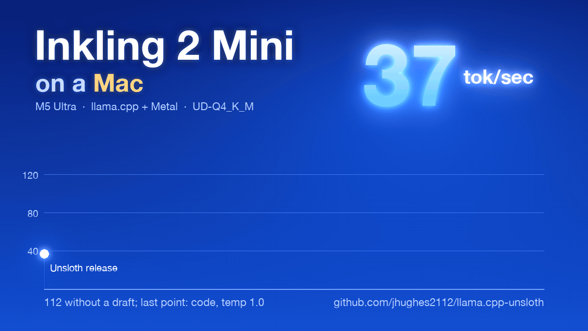
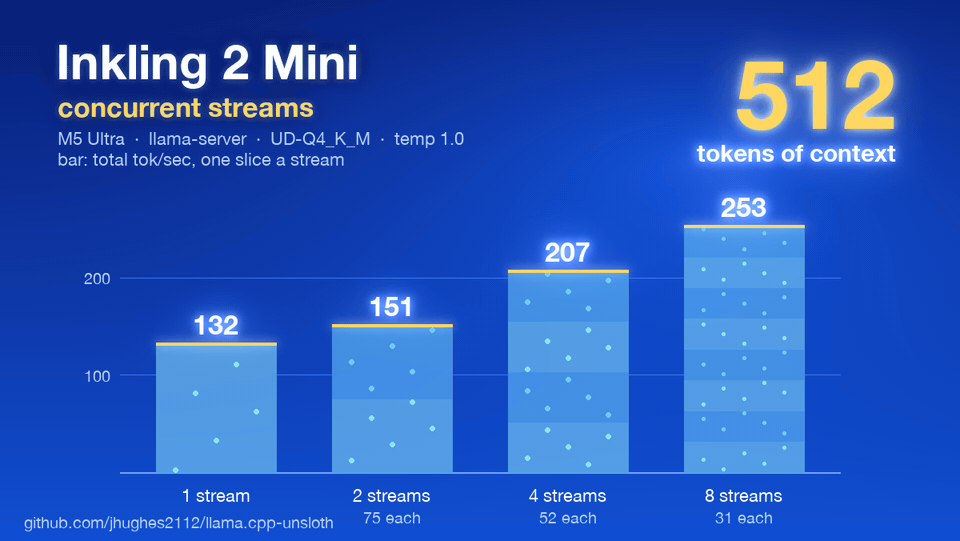

# Inkling 2 Mini on a Mac: 37 → 137 tok/sec on one stream (M5 Ultra)



This branch is Unsloth's llama.cpp release `b12588-mix-c0c3de8` with the Metal backend reworked for
[Inkling 2 Mini](https://huggingface.co/unsloth/Inkling-2-Mini-GGUF). **All numbers on this page were measured on an
Apple M5 Ultra** with `llama-server`, at the model's own sampling settings (temperature 1.0; no speed was measured
greedy). Smaller Apple chips will be slower.

### It answers like the original

Faster kernels are only worth having if the model still says the same thing, and it does. Against the untouched
Unsloth release, run on the same model file:

- **The same top token 99.1% of the time**, with a mean KL divergence of 0.0008 between the two builds' next-token
  probabilities. Choosing the 4-bit file over the 8-bit one moves the model four times as much as everything in this
  branch.
- **Closer to the original than the original is to itself.** Switching off the original's own fused kernels changes
  its output more than this whole branch does. Floating-point sums depend on the order of the additions, so no fused
  kernel is bit-identical to an unfused one; where greedy outputs part at all, it is at a near tie between two equally
  likely words ("Two-pointer merge" or "Classic two-pointer merge"), and the answer stays the same.

### Speed, one stream, M5 Ultra

Decode tok/sec by how much context comes before the reply (a real C++ or Markdown context of that many tokens, then a
code or prose task, 300 tokens generated, mean of three seeds):

| context | code | prose |
|---|---|---|
| short prompt | 137 | 136 |
| 1K tokens | 128 | 128 |
| 4K tokens | 126 | 127 |
| 8K tokens | 124 | 124 |
| 32K tokens | 110 | 110 |

The speed is the same for every kind of text; the rows are three seeds each.

The untouched Unsloth release decodes 37 tok/sec on the same machine.

### Several streams at once



`llama-server --parallel N` decodes all its streams together: each step runs one token of every stream through the
same fused kernels. Total tok/sec, with each stream's own speed in brackets (each stream its own real C++ or Markdown
context of that size, 256 tokens generated, temperature 1.0, two seeds):

| context | 1 stream | 2 streams | 4 streams | 8 streams |
|---|---|---|---|---|
| 512 tokens | 132 | 151 (75 each) | 207 (52 each) | 253 (31 each) |
| 4K tokens | 126 | 145 (72 each) | 198 (49 each) | 241 (30 each) |
| 32K tokens | 109 | 125 (62 each) | 165 (41 each) | 195 (24 each) |

Eight streams give about twice the total of one. Context costs more as streams are added, because attention reads
every stream's own cache: from 512 to 32K tokens one stream loses 17%, eight lose 23%. `-c` must hold every stream
(`-c 262144 --parallel 8` for eight 32K contexts).

### Why there is no draft model

Speculative decoding, where a small model drafts a few tokens and the large one checks them all in one pass, is the
usual way to speed up decode. Every drafter we could find for Inkling 2 Mini was tested on this branch, and none of them
pays on this machine, so it runs without one.

- **DSpark**, the multi-token-prediction head Thinking Machines ships with the model (also tested as community 4-bit
  versions, which behaved the same): 75% of single drafts accepted on code and 51% on prose, fewer as the drafts get
  longer (55% and 26% at three). At every length from one draft to five it was slower than plain decode: 99 to 113
  tok/sec on code and 52 to 93 on prose, against 137.
- **DFlash2** (Inco AI), the strongest we found: a real gain on short coding prompts (159 tok/sec against 133 at the
  time), but drafter and model agree less as the context grows. With 1K tokens of context the gain was 5%; from 4K
  on there was none (126 against 126 at 4K, 111 against 110 at 32K). Drafting every token at temperature 1.0 made
  prose slower (75 against 110 at the time).

The reason is the price of checking a draft. Each extra token in a verify pass reads its own experts, about 2 to 2.5
ms here, where a whole plain token takes about 7 ms, so a draft has to be accepted most of the time just to break even,
and the faster plain decode gets, the higher that bar. These drafters are good work, and on slower engines they help;
on a decoder this optimized they make it slower, and the GPU and memory bandwidth are better spent on the model itself.

### What you need

- macOS on Apple Silicon, Xcode command line tools, CMake, Python 3 with `huggingface_hub`.
- The model: Unsloth's **`UD-Q4_K_M`** GGUF (16.6 GB) and its image projector `mmproj-BF16.gguf` (0.6 GB), both from
  the root of the repo: the mainline layout (`inkling2_loop`) that upstream llama.cpp reads too. The older files in
  `Old_Support` still load here and give identical output.

### Build

```bash
git clone -b metal-inkling2-fuse https://github.com/jhughes2112/llama.cpp-unsloth
cd llama.cpp-unsloth
cmake -S . -B build -DCMAKE_BUILD_TYPE=Release
cmake --build build -j
```

Do not clone under `/tmp`: the web UI packaging step of the server build fails there.

### Get the model (exactly these two files)

```bash
pip install -U huggingface_hub
hf download unsloth/Inkling-2-Mini-GGUF Inkling-2-Mini-UD-Q4_K_M.gguf mmproj-BF16.gguf --local-dir models
```

### Run

```bash
# OpenAI-compatible server with image input, at http://127.0.0.1:8080
build/bin/llama-server -m models/Inkling-2-Mini-UD-Q4_K_M.gguf --mmproj models/mmproj-BF16.gguf \
    -c 32768 -ngl 99 -fa on --jinja -t 2 -ot "token_embd\.weight=MTL0" --backend-sampling

# measure decode speed
build/bin/llama-bench -m models/Inkling-2-Mini-UD-Q4_K_M.gguf -p 0 -n 400 -r 3
```

- `--backend-sampling` draws the next token on the GPU, so nothing of the 200K-token vocabulary goes back to the CPU.
- `-ot "token_embd\.weight=MTL0"` keeps the token embeddings on the GPU, `-t 2` is enough CPU threads for what is left.

### Credits

- [Thinking Machines](https://huggingface.co/thinkingmachines/Inkling-2-Mini) for Inkling 2 Mini.
- [Unsloth](https://github.com/unslothai/llama.cpp) for the llama.cpp release this branch is built on, its Inkling 2
  support, and the `UD-Q4_K_M` quant.
- The llama.cpp and ggml authors.

### Good to know

- Where the speed came from: the model's small ops are fused into single Metal kernels (541 dependent GPU steps a token,
  from 920), per-channel work runs in the epilogues of the mat-vecs, the token is drawn on the GPU, the CPU waits by
  polling, and the command buffer for the next token is encoded while the GPU runs the current one.
- Only the Metal backend changed. CUDA, Vulkan and CPU run as in the Unsloth release.
- Leave the K/V cache at its default (F16).
- Both GGUF layouts of Inkling 2 Mini load: the mainline one (`inkling2_loop`, 24 layers and the loop in its keys) and
  the older Unsloth one (`inkling2`, one block per layer visit). The same weights give the same tokens either way.
- Several streams (`--parallel N`) take the same fused paths as one; the numbers above are from this build.
- `GGML_METAL_PROFILE=1` prints GPU time, kernels and serial steps a token. `GGML_METAL_FUSION_DISABLE=1` runs
  without the fused kernels, for comparison.
- The base is a frozen release, so this branch does not follow upstream llama.cpp.

---

# llama.cpp


<div align="center">

<b>LLM inference in C/C++</b>

[](https://opensource.org/licenses/MIT)
[](https://github.com/ggml-org/llama.cpp/releases?q=tag:v1)
[](https://github.com/ggml-org/llama.cpp/releases?q=b)
[](https://github.com/ggml-org/llama.cpp/actions/workflows/server.yml)
[](https://github.com/ggml-org/llama.cpp/actions/workflows/docker.yml)
[](https://github.com/ggml-org/llama.cpp/actions/workflows/winget.yml)

[v1.0.0](https://huggingface.co/blog/ggml-org/llama-cpp-v1) / [ggml](https://github.com/ggml-org/ggml) / [ops](https://github.com/ggml-org/llama.cpp/blob/master/docs/ops.md) / [maintainer PRs](https://github.com/ggml-org/llama.cpp/pulls?q=is%3Apr%20is%3Aopen%20draft%3AFalse%20(author%3Asanmai%20OR%20author%3Argerganov%20OR%20author%3AKitaitiMakoto%20OR%20author%3Adanbev%20OR%20author%3Aaldehir%20OR%20author%3Amax-krasnyansky%20OR%20author%3ACISC%20OR%20author%3Aggerganov%20OR%20author%3Aam17an%20OR%20author%3Ajhen0409%20OR%20author%3Abartowski1182%20OR%20author%3Anikwen%20OR%20author%3Ahipudding%20OR%20author%3Aravi9%20OR%20author%3AServeurpersoCom%20OR%20author%3Athelittlefireman%20OR%20author%3Apwilkin%20OR%20author%3Areeselevine%20OR%20author%3Angxson%20OR%20author%3Ajeffbolznv%20OR%20author%3Amarty1885%20OR%20author%3A0cc4m%20OR%20author%3ATitaniumtown%20OR%20author%3Aangt%20OR%20author%3AIMbackK%20OR%20author%3Aarthw%20OR%20author%3AJohannesGaessler%20OR%20author%3AORippler%20OR%20author%3Aruixiang63%20OR%20author%3Axctan%20OR%20author%3AmasterFoad%20OR%20author%3Aallozaur%20OR%20author%3AAndreas-Krebbel%20OR%20author%3Ayomaytk%20OR%20author%3Aaendk%20OR%20author%3Awine99%20OR%20author%3Agaugarg-nv%20OR%20author%3Ataronaeo%20OR%20author%3Aforforever73%20OR%20author%3Achaxu01%20OR%20author%3Alhez%20OR%20author%3AAlekseiNikiforovIBM%20OR%20author%3Anetrunnereve%20OR%20author%3Afairydreaming%20OR%20author%3Aynankani)%20sort%3Aupdated-desc) / [dev stats](https://github.com/ggml-org/llama.cpp-dev) / [lib llama API](https://github.com/ggml-org/llama.cpp/issues/9289) / [llama-server REST API](https://github.com/ggml-org/llama.cpp/issues/9291)

</div>

## Description

The main goal of `llama.cpp` is to enable LLM (and MLLM) inference with minimal setup and state-of-the-art performance on a wide range of hardware - locally and in the cloud.

The `llama.cpp` project is built on top of the [ggml](https://github.com/ggml-org/ggml) library.

## Quick start

A few options to get `llama.cpp` installed on your machine:

```bash
# curl
curl -LsSf https://llama.app/install.sh | sh

# powershell
irm https://llama.app/install.ps1 | iex
```

- Visit https://llama.app and follow the instructions
- Run with Docker - see our [Docker documentation](docs/docker.md)
- Download pre-built binaries from the [releases page](https://github.com/ggml-org/llama.cpp/releases)
- Build from source by cloning this repository - check out [our build guide](docs/build.md)

Once installed:

```sh
# Download and run a model directly from Hugging Face
llama cli -hf ggml-org/Qwen3.5-0.8B-GGUF

# Launch OpenAI-compatible API server
llama serve -hf ggml-org/Qwen3.5-0.8B-GGUF
```

<table align="center">
    <tr>
        <td align="center" width=50%>
            
            <i>VLM session with <b>llama cli</b></i>
        </td>
        <td align="center">
            
            <i>Llama Chat, the built-in chat app, against <b>llama serve</b></i>
        </td>
    </tr>
<table>

## Documentation

#### Tools

- [cli](tools/cli/README.md)
- [completion](tools/completion/README.md)
- [server](tools/server/README.md)
- [Text-to-speech (TTS) models](docs/multimodal/tts.md)
- [GBNF grammars](grammars/README.md)

#### Development

- [How to build](docs/build.md)
- [Running on Docker](docs/docker.md)
- [Build on Android](docs/android.md)
- [Multi-GPU usage](docs/multi-gpu.md)
- [Performance troubleshooting](docs/development/token_generation_performance_tips.md)
- [GGML tips & tricks](https://github.com/ggml-org/llama.cpp/wiki/GGML-Tips-&-Tricks)
- [XCFramework](docs/xcframework.md)
- [Completions](docs/completions.md)
- [Models](docs/models.md)
- [Release process](docs/release.md)

## Contributing

- Contributors can open PRs
- Collaborators will be invited based on contributions
- Maintainers can push to branches in the `llama.cpp` repo and merge PRs into the `master` branch
- Any help with managing issues, PRs and projects is very appreciated!
- Read the [CONTRIBUTING.md](CONTRIBUTING.md) for more information

## Acknowledgements

- [yhirose/cpp-httplib](https://github.com/yhirose/cpp-httplib) - Single-header HTTP server, used by `llama-server` - MIT license
- [nothings/stb](https://github.com/nothings/stb) - Single-header image format decoder, used by multimodal subsystem - Public domain
- [nlohmann/json](https://github.com/nlohmann/json) - Single-header JSON library, used by various tools/examples - MIT License
- [mackron/miniaudio](https://github.com/mackron/miniaudio) - Single-header audio format decoder, used by multimodal subsystem - Public domain
- [sheredom/subprocess.h](https://github.com/sheredom/subprocess.h) - Single-header process launching solution for C and C++ - Public domain
